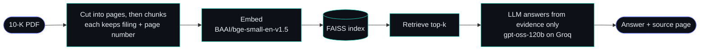

<!-- ============================================================
  README - RAG Q&A over SEC 10-K filings (FinanceBench) with Evaluation
  Put this README.md in the root of the RAG-Based-Domain-Document-Q-A-System-with-Evaluation repo.
  Also upload these 3 images into the root of that repo (no folder):
    rag-eval.png, rag-retrieval-scope.png, rag-answer-breakdown.png
  Search "EDIT" for the things to check before publishing.
  Palette: slate #0D1117 · text #E6EDF3 · teal #2DD4BF · indigo #818CF8
============================================================= -->

<div align="center">


<br/>


</div>

---

## Overview

Every public company files a 10-K: roughly two hundred pages of legal language, tables and footnotes, with the number you need sitting on exactly **one page**.

Many AI systems don't look for that page, they **guess**, and a confident wrong number in finance is worse than silence. This project searches the filing, finds the evidence, answers with the **source page attached**, and when it can't find the answer, it **says so**.

It then **audits itself** page by page to find exactly where it fails. Built on [FinanceBench](https://github.com/patronus-ai/financebench).

---

## Pipeline



| Stage | Tool |
|:--|:--|
| PDF parsing | PyMuPDF |
| Embeddings | `BAAI/bge-small-en-v1.5` |
| Vector search | FAISS (inner product, normalised) |
| LLM | `openai/gpt-oss-120b` via Groq |
| Interface | Gradio |

**The one rule for the LLM:** answer only from the evidence provided. If it isn't there, say so.

---

## Dataset

A **7-question** subset of FinanceBench over **7 10-K filings**, with reference answers and evidence pages (`data/financebench_data.csv`). The 10-K PDFs are pulled automatically from the FinanceBench repo.
<!-- EDIT: the Dataset section in your old README was cut off. Check this description is accurate. -->

---

## Results

### Stage 1 · Did the retriever find the right page?

<div align="center">
<a href="https://github.com/nehareddy-web/RAG-Based-Domain-Document-Q-A-System-with-Evaluation/blob/main/rag-retrieval-scope.png">

</a>
</div>

| Where it searched | Hit@1 | Hit@3 | Hit@5 | MRR |
|:--|:-:|:-:|:-:|:-:|
| Inside the correct filing | 0.429 | 0.429 | 0.571 | **0.464** |
| Across all 7 filings | 0.000 | 0.429 | 0.429 | 0.190 |

> **Finding 1.** Telling the retriever *which filing to search* lifts MRR from **0.19 to 0.46**. Without that hint, the correct page was never ranked first.

### Stage 2 · Does chunk size matter?

<div align="center">
<a href="https://github.com/nehareddy-web/RAG-Based-Domain-Document-Q-A-System-with-Evaluation/blob/main/rag-eval.png">

</a>
</div>

| Chunk size | Overlap | Chunks | Hit@1 | Hit@3 | Hit@5 | Hit@10 | MRR |
|:-:|:-:|--:|:-:|:-:|:-:|:-:|:-:|
| 500 | 75 | 10,245 | 0.429 | 0.429 | 0.571 | 0.571 | 0.464 |
| 1000 | 150 | 5,407 | 0.429 | 0.429 | 0.571 | 0.571 | 0.464 |
| 1500 | 200 | 3,728 | 0.429 | 0.429 | 0.571 | **0.714** | 0.475 |

> **Finding 2.** Bigger chunks help slightly at Hit@10, but the difference is tiny. Chunk size is not the main bottleneck.

### Stage 3 · Final verdict

Chunk size 1000 · top-5 · graded by an LLM judge against the reference answer.

| Metric | Result |
|:--|:--|
| Answer accuracy | **2 / 7** (28.6%) |
| Right page retrieved | **4 / 7** (57.1%) |

*Seven questions can't support strong conclusions, so treat these results as directional.*

---

## Key Insight: Retrieval Is the Bottleneck

<div align="center">
<a href="https://github.com/nehareddy-web/RAG-Based-Domain-Document-Q-A-System-with-Evaluation/blob/main/rag-answer-breakdown.png">

</a>
</div>

| What happened | Questions | Answered correctly |
|:--|:-:|:-:|
| Right page **never found** | 3 | **0 / 3** |
| Right page found | 4 | **2 / 4** |

In all 3 cases where the evidence was missing, the system did **not** invent an answer. It said:

> *"I could not find it."*

**The language model was not the problem; the retriever was.** When the right page did surface, the answers were correct:

- FY2021 unadjusted EBITDA: $1,196M + $636M = **$1,832M** ✅
- Best Buy 3-year average net profit margin: **2.8%** ✅

---

## Failure Analysis

| Question | Why it failed |
|:--|:--|
| AmEx card member retention (2022) | Retriever never found the page |
| Best Buy FY2019 inventories | Retriever never found the page |
| Best Buy gross margin consistency | Retriever never found the page |
| AWW working capital (FY2022) | Evidence spans **2 pages**; only 1 was retrieved, so current assets went missing |
| AWW cash dividends (FY2020) | Right page found, but the number wasn't inside the retrieved chunks |

Per-question results: [`outputs/answer_eval_results.csv`](outputs/answer_eval_results.csv)

---

## Next Steps

- [ ] **Hybrid search (BM25 + embeddings):** exact figures like "5,409" are keyword problems, and dense search is weak at them
- [ ] **Cross-encoder reranker:** re-score the top candidates before the LLM sees them
- [ ] **Table-aware parsing:** financial answers live in tables, and plain text extraction flattens them
- [ ] **Full 150-question FinanceBench:** seven questions can't support strong conclusions

---

## Run It Yourself

1. Open `financebench_rag.ipynb` in **Google Colab** (GPU runtime recommended).
2. Add a free [Groq](https://console.groq.com) API key as a Colab Secret named `GROQ_API_KEY` (notebook access **ON**).
3. Upload `data/financebench_data.csv` when prompted and run the cells in order. The 10-K PDFs are pulled automatically from the FinanceBench repo.

```
financebench-rag-qa
 ├── financebench_rag.ipynb     the full investigation (Colab)
 ├── data/                      questions, answers, evidence
 ├── outputs/                   evaluation results (CSV)
 ├── screenshots/               results and demo
 └── requirements.txt
```

---

<div align="center">

[](https://github.com/nehareddy-web)
[](https://linkedin.com/in/nehareddy11)


</div>
